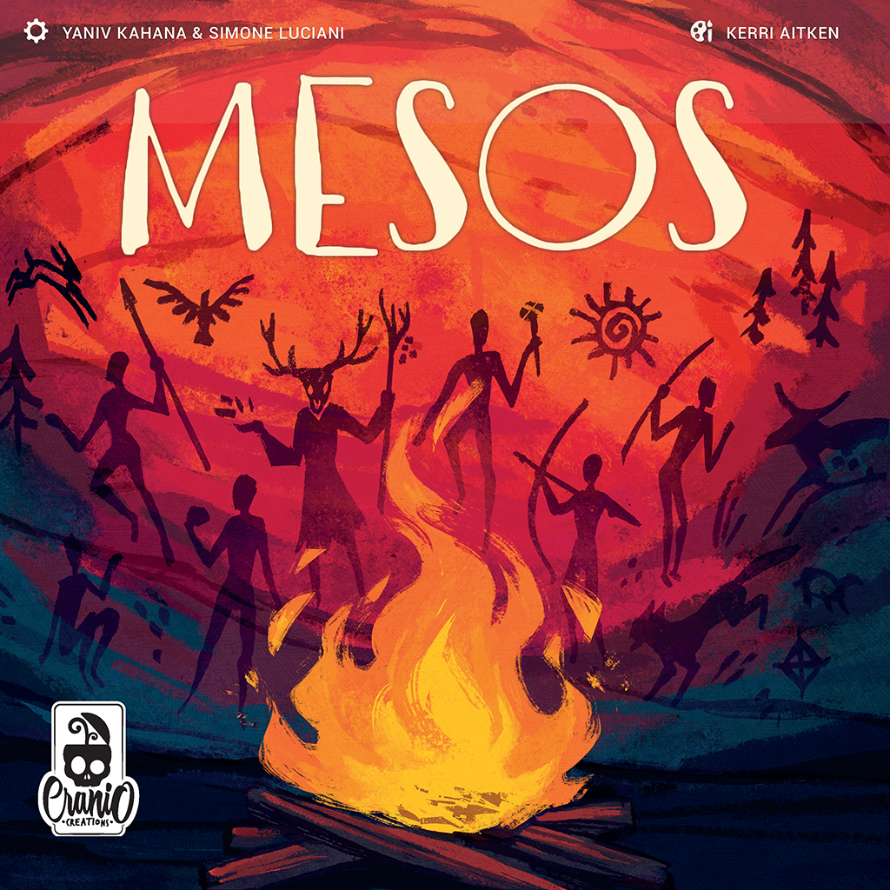

<h1 align="center">
    <a href="https://www.craniocreations.it/prodotto/mesos/">
        
    </a>
    <br>
    Mesos
    <br>
</h1>
<h4 align="center">Software Engineering Project at Politecnico di Milano, A.Y. 2025-2026</h4>
<p align="center">
    <a href="https://github.com/gilbertobrambilla">Gilberto Brambilla</a> •
    <a href="https://github.com/alethegoat">Alessio Capra</a> •
    <a href="https://github.com/baccangabriele">Gabriele Baccan</a> •
    <a href="https://github.com/giuliablanchetti">Giulia Blanchetti</a>
</p>
<p align="center">
    <strong>Final Grade: 30/30 cum laude</strong>
</p>

## 🚀 About the project

Digital implementation of the board game [Mesos](https://www.craniocreations.it/prodotto/mesos/) by Cranio Creations.

The development of this project is part of the Software Engineering course at the Politecnico di Milano. As a final examination project, it is a requirement for the bachelor's degree in Computer Engineering. The course was held by Prof. Alessandro Margara in the academic year 2025-2026.

The application is a distributed multi-user system featuring both graphical (GUI) and terminal (TUI) interfaces. It thoroughly implements the official board game rules and supports multiple clients connected to a central server through either RMI or socket communication.

## 📋 Implemented Features

The project implements the following requirements and advanced features:

| Feature                         | Implemented |
|:--------------------------------|:-----------:|
| Complete rules                  |      ✅     |
| TUI                             |      ✅     |
| GUI                             |      ✅     |
| Socket                          |      ✅     |
| RMI                             |      ✅     |
| Multiple Games                  |      ✅     |
| Client Disconnection Resilience |      ✅     |
| Database Leaderboard            |      ✅     |
| Server Persistence              |      ❎     |

## 📚 Documentation

All project documentation can be found under the `/documentation` directory of this repository.

### UML
The UML folder contains the project class diagram and the sequence diagrams describing the network architecture. The class diagram includes all model classes and the relevant parts of the controller, while the sequence diagrams describe specific usage scenarios.

### Javadoc

The most important classes and methods are fully documented. The Javadoc provides deeper insights into the codebase and architectural choices.

## 🧪 Test Cases

| Package | Coverage |
|:--------|:--------:|
| Model   |   95%    |

## ⚙️ Requirements

- Java JDK 25
- MySQL server
- Maven

Before starting the server, make sure MySQL is running and import the database schema:

```bash
mysql -u root -p < src/main/resources/mesos.sql
```

If needed, update the database credentials in:

```text
src/main/resources/database.json
```

## 🛠️ Build

From the project root, run:

```bash
./mvnw clean package
```

On Windows:

```bash
mvnw.cmd clean package
```

The build generates two executable JARs:

```text
target/server.jar
target/client.jar
```

## 🎮 How to Run

Start the server:

```bash
java -jar target/server.jar
```

Start one or more clients:

```bash
java -jar target/client.jar
```

The applications will prompt for the required network configuration. The client allows choosing between TUI and GUI mode at startup.

## 💻 Tools and Technologies

- IntelliJ IDEA Ultimate
- Maven
- Git
- JUnit
- JavaFX
- JLine
- MySQL

## ⚠️ Disclaimer

Mesos is a board game developed and published by Cranio Creations Srl.

All graphical assets in this project related to the official board game have been used solely for educational purposes.

Distribution, copying, reproduction, publication, or use of this material outside this project is forbidden.

Commercial use of this material is strictly forbidden.

Enjoy the game!
